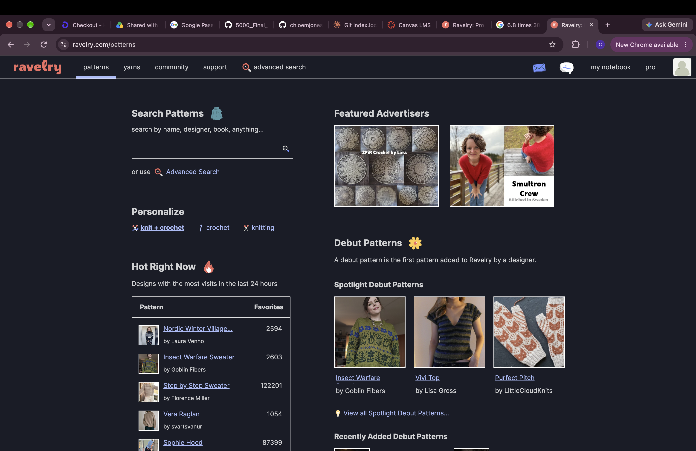

# Overview

### **What is Raverly?**

Its a website and online database full of knitting and crochet patterns, where users can post patterns, buy patterns, and then comment, favorite, and rate those patterns.

{fig-align="center" width="500"}

### **What am I collecting?**

Using the Ravlery API i am collecting pattern level data including pattern id, type of pattern( knitting or crochet), yarn, yardage, price, ratings, difficulty, number of favorites, and projects made.

### **Goal**

The goal of collecting this data is to ultimately predict what makes a pattern popular and the difference between knitting and crochet patterns.

### Movtivation

I love knitting and crocheting and someday when I have lots of free time I would love to develop and post patterns on Ravlery. So this project can help future me and current sellers know what makes a pattern popular/ successful and what kind of projects get the most engagement to focus on what to sell.

### Objectives

- Build a dataset by collecting at least 30,000 patterns and subsets for crochet and knitting

- Find natural pattern types by clustering by features

- Explain popularity through modeling

- Compare knitting and crochet on difficulty yardage, price, and other factors